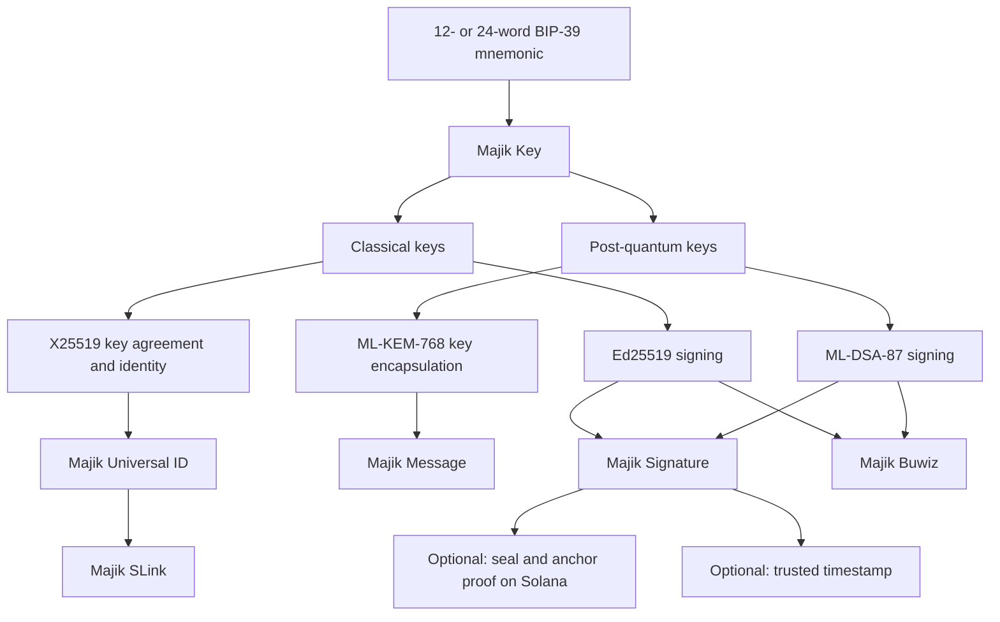

# Majikah — Post-Quantum Security for People, Creators, and Businesses

> **One key. Five products. Proof you can verify.**
>
> Local-first cryptographic tools for what you send, what you create, and what you own.

**Majikah Solutions OPC** is a founder-led software company based in the Philippines, building post-quantum-ready security products and open-source developer tools for digital trust. Our ecosystem brings together file authenticity, encrypted communication, cryptographic identity, URL ownership proofs, and signed-by-default invoicing around a shared key architecture.

We build with established cryptographic standards—including **ML-KEM (FIPS 203)** and **ML-DSA (FIPS 204)**—and aim to make these capabilities practical for everyday users, creators, developers, and businesses.

 

---

## What We Build

We are building a connected product suite around a simple idea: **digital trust should be based on cryptographic proof that people can independently check—not only on platform accounts, file names, or badges.**

| Need | How Majikah addresses it | Core technology |
|---|---|---|
| **Prove a file is authentic** | Sign, seal, and verify documents and other digital content | Ed25519 + ML-DSA-87 (FIPS 204) |
| **Keep messages private** | Post-quantum-ready key encapsulation and encrypted messaging | ML-KEM-768 (FIPS 203), AES-256-GCM |
| **Own a portable cryptographic identity** | Derive public identity from a user-controlled Majik Key | BIP-39, X25519, Ed25519 and post-quantum keys |
| **Prove control of a URL** | Publish a verifiable cryptographic claim for a website, channel, or profile | Majik Key + signed claims |
| **Protect business records** | Build invoice workflows around encrypted data and verifiable signatures | Majik Key + hybrid signing |
| **Prove a sealed file existed in a particular state** | Anchor a sealed-file proof to a public blockchain | SHA3-512 seal hash + Solana transaction record |

Majikah uses standardized cryptographic primitives; our engineering work focuses on their composition, key management, product workflows, and integration. Post-quantum algorithms improve resistance to certain future quantum attacks, but no product should be described as invulnerable or guaranteed secure indefinitely.

---

## The Majikah Suite

### ✍️ [Majik Signature](https://majikah.solutions/products/majik-signature) — Flagship Product

**Hybrid post-quantum file signing and verification, designed to work locally.**

Majik Signature signs files with **Ed25519 + ML-DSA-87** and allows recipients to verify signatures without needing the signer's private key or a Majikah account. It supports documents, images, audio, video, Office files, source code, and other binary content.

Highlights include:

- Embedded signatures and detached `.mjksig` envelopes.
- Batch and folder workflows using `.mjksmap` manifests.
- Multi-party signing, signer allowlists, envelope sealing, and signing-order verification.
- Optional trusted timestamps issued by a timestamp authority.
- **Majik Notary**: anchoring a sealed file's proof on Solana, so the on-chain record can be checked independently of Majikah's own systems.
- CLI and MCP workflows for approved signing, sealing, and verification requests.
- Core signing and verification run locally; timestamping and on-chain anchoring require network access.

**Available:** [Web app](https://signature.majikah.solutions) · [Windows, Linux & web downloads](https://majikah.solutions/products/majik-signature/download) · [Microsoft Store](https://apps.microsoft.com/detail/9pl9g3xzvd1x) · [Documentation](https://majikah.solutions/products/majik-signature/docs) · [SDK repository](https://github.com/Majikah/majik-signature)

Core signing and verification are free. Trusted timestamps and Majik Notary are optional services with separate usage-based pricing; see the [official website](https://majikah.solutions/) for current terms.

### 🔐 [Majik Message](https://message.majikah.solutions) — Encrypted Messaging

**Private communication built around cryptographic identity, not a phone-number-first model.** Majik Message uses ML-KEM-768 for post-quantum key encapsulation and authenticated encryption for message content. Its architecture includes ephemeral real-time conversations and persistent threads with separate integrity and deletion workflows.

- Seed-phrase-based cryptographic identity.
- Real-time chats with automatic expiration.
- Persistent threads with hash-chain integrity and participant-controlled deletion workflows.
- Encrypted file attachments and local attachment scanning in supported flows.
- Web, desktop, and browser-based access options.

**Available:** [Web app](https://message.majikah.solutions) · [Microsoft Store](https://apps.microsoft.com/detail/9pmjgvzzjspn) · [Chrome extension](https://chromewebstore.google.com/detail/majik-message/dhlafmkpgjagkhiokoighjaakajbckck) · [Official repository](https://github.com/Majikah/majik-message) · [Documentation](https://majikah.solutions/products/majik-message/docs)

Privacy note: encryption does not protect against a compromised device, malware, screenshots, or information a recipient chooses to share. Network relays may observe connection metadata such as IP addresses.

### 🧾 [Majik Buwiz](https://majikah.solutions/products/majik-buwiz) — Invoicing

**Offline-first invoice workflows with cryptographic integrity built in.** Majik Buwiz applies hybrid signatures to invoice financial content and supports local verification, helping recipients detect changes to signed records.

Majik Buwiz is available for Windows. Some accounting and cloud-exchange capabilities are being reworked and may be disabled in current builds; consult the product documentation for the status of individual features.

**Available:** [Product page and documentation](https://majikah.solutions/products/majik-buwiz) · [Microsoft Store](https://apps.microsoft.com/detail/9mzz1gm9238r)

### 🪪 [Majik Universal ID](https://majikah.solutions/products/majik-universal-id) — Public Cryptographic Identity

A public identity built on Majik Key and verifiable signing keys. Universal ID profiles can help people and organizations publish a stable cryptographic identity and let others verify signatures against keys associated with that identity.

**Available:** [Product page](https://majikah.solutions/products/majik-universal-id) · [Identity profiles](https://id.majikah.solutions/)

### 🔗 [Majik SLink](https://majikah.solutions/products/majik-slink) — URL Ownership Proofs

Majik SLink provides a signed claim connecting a Majik Key identity to a URL, such as a website, creator page, or social profile. It is designed to provide a cryptographic proof that can be checked independently—not to replace a platform's own account recovery or security controls.

**Available:** [Product page](https://majikah.solutions/products/majik-slink)

---

## The Shared Foundation: [Majik Key](https://github.com/Majikah/majik-key)

Majik Key is the open-source cryptographic identity library used across the suite. It derives a set of classical and post-quantum keys from a BIP-39 mnemonic and protects stored private key material with authenticated encryption and passphrase-based key derivation.

The default core key set includes:

| Key ID | Algorithm | Role |
|---|---|---|
| `classic:x25519` | X25519 | Identity and classical key agreement |
| `classic:ed25519` | Ed25519 | Classical digital signatures |
| `pq:ml-kem-768` | ML-KEM-768 (FIPS 203) | Post-quantum key encapsulation |
| `pq:ml-dsa-87` | ML-DSA-87 (FIPS 204) | Post-quantum digital signatures |
| `web3:sol` | Solana key derived on demand | Experimental Web3 integration |

Additional key types are available where supported, including other ML-KEM and ML-DSA parameter sets, SLH-DSA, and experimental Bitcoin/Ethereum integrations. Experimental or opt-in features should not be treated as equivalent in maturity to the core key set.

Majik Key's key creation and derivation run locally without a network request. Recovery depends on the mnemonic, the derivation options used, and the product-specific backup model. **A seed phrase is a master secret:** anyone who obtains it may be able to recreate the associated keys. Never share it, paste it into a website, or commit it to source control.

- [TypeScript repository](https://github.com/Majikah/majik-key)
- [npm package](https://www.npmjs.com/package/@majikah/majik-key)
- [Rust crate — early development](https://crates.io/crates/majik-key)
- [Technical whitepaper](https://doi.org/10.5281/zenodo.23208491)
- [Majikah explainer](https://majikah.solutions/articles/majik-key-whitepaper)

---

## Architecture at a Glance

A shared key architecture reduces the need to create unrelated identities for each product. It does **not** mean all product data is automatically synchronized or recoverable from a mnemonic alone; users should follow the backup and recovery guidance for each product.

---

## Cryptographic Building Blocks

| Primitive | Use in the ecosystem |
|---|---|
| **ML-KEM-768 — FIPS 203** | Post-quantum key encapsulation for establishing shared secrets |
| **ML-DSA-87 — FIPS 204** | Post-quantum digital signatures |
| **Ed25519** | Classical signatures paired with ML-DSA-87 in hybrid signing |
| **X25519** | Classical key agreement and identity-related operations |
| **AES-256-GCM** | Authenticated encryption for encrypted payloads and stored secrets |
| **Argon2id** | Memory-hard passphrase-based key derivation for key storage |
| **BIP-39** | Standardized mnemonic format used as an input to deterministic key derivation |
| **SHA-256 / SHA3-512** | Content hashing and sealing/integrity workflows, depending on the protocol |

Majik Signature requires both Ed25519 and ML-DSA-87 verification to pass for its hybrid signatures. This provides defense in depth across classical and post-quantum schemes, but does not eliminate risks from compromised endpoints, incorrect identity assumptions, implementation defects, weak passphrases, or insecure backups.

---

## Open-Source SDK Family

Majikah publishes libraries for developers who want to integrate cryptographic identity, encryption, and signatures into their own applications. See each repository for current maturity, API status, support guarantees, and security notes.

| Package | Purpose |
|---|---|
| [`@majikah/majik-key`](https://github.com/Majikah/majik-key) | Key generation, deterministic key derivation, key registry, encrypted key storage |
| [`@majikah/majik-signature`](https://github.com/Majikah/majik-signature) | Hybrid content signing, verification, file embedding, detached envelopes, multi-party signing and sealing |
| [`@majikah/majik-message`](https://github.com/Majikah/majik-message) | Messaging protocol and cryptographic integration |
| [`@majikah/majik-envelope`](https://github.com/Majikah/majik-envelope) | Multi-recipient encryption envelope primitives |
| [`@majikah/majik-file`](https://github.com/Majikah/majik-file) | Encrypted file format and `.mjkb` workflows |
| [`@majikah/majik-bytes`](https://github.com/Majikah/majik-bytes) | Byte operations and encoding utilities |
| [`@majikah/majik-contact`](https://github.com/Majikah/majik-contact) | Contact and public-key identity structures |

Browse [all Majikah npm packages](https://www.npmjs.com/~majikah). The SDKs are released under Apache-2.0 where stated in their repositories. Public source enables inspection; it should not be mistaken for a completed independent security audit.

### Developer Platform

For SDK documentation, API references, and integration guidance, visit **[developers.majikah.solutions](https://developers.majikah.solutions)**.

---

## Product Availability

Availability varies by product and release channel. Check the linked product page before relying on a platform or a specific feature.

| Product | Web | Windows | Linux | Browser extension / PWA |
|---|:---:|:---:|:---:|:---:|
| Majik Signature | ✅ | ✅ | ✅ | — |
| Majik Message | ✅ | ✅ | Release channel | Chrome / PWA |
| Majik Buwiz | — | ✅ | — | — |
| Majik Universal ID | ✅ | — | — | — |
| Majik SLink | ✅ | — | — | — |

---

## Trust, Research, and Security Posture

- **NIST-standardized primitives:** Majik Key and Majik Signature use ML-KEM (FIPS 203) and ML-DSA (FIPS 204) alongside established classical algorithms.
- **Open-source SDKs:** inspect implementations, release history, tests, and threat-model notes in the linked repositories.
- **Technical whitepaper:** [Majik Key on Zenodo](https://doi.org/10.5281/zenodo.23208491), with derivation details and limitations.
- **Antivirus vendor whitelisting:** Majik Signature is listed as whitelisted by [Avast](https://www.avast.com/) and [Kaspersky](https://www.kaspersky.com/). Vendor whitelisting is not a cryptographic audit or guarantee that every environment is safe.
- **Offline core workflows:** Majik Key generation/derivation and Majik Signature signing and verification can run locally. Optional timestamping, public identity lookups, messaging, and blockchain anchoring have network-dependent components.

### Important Security Limitations

No independent third-party security audit of the core Majik Key implementation is currently claimed here. A published whitepaper, public source code, test suite, antivirus whitelisting, and use of standardized algorithms are useful transparency signals, but they are not substitutes for an external audit or a formal security proof of the full product system.

Cryptographic signatures prove that content matches a signature created by a particular key. They do not by themselves establish the real-world legal identity of the key holder, that a signer had legal authority, or that a signed document is legally valid in every jurisdiction. Verify signer identity through a trusted channel and consult qualified counsel for legal requirements.

Majikah products are not a substitute for endpoint security. Malware, device compromise, exposed seed phrases, weak passwords, and social engineering can undermine otherwise sound cryptography. Review product-specific documentation for threat models and operational guidance.

---

## Company and Current Focus

Majikah Solutions OPC is a Philippine, founder-led software company building and commercializing its own cryptographic products and developer infrastructure. The product suite has moved beyond the initial MVP stage; ongoing work focuses on product hardening, distribution, customer validation, developer adoption, and sustainable growth.

We are interested in aligned partnerships across cybersecurity, developer infrastructure, digital trust, creator tools, and small-business software—particularly partners who value practical security, open-source building blocks, and responsible communication about limitations.

---

## Connect

| | |
|---|---|
| **Website** | [majikah.solutions](https://majikah.solutions) |
| **Services** | [majikah.solutions/services](https://majikah.solutions/services/discovery) |
| **Support** | [Submit a support request](https://majikah.solutions/support) |
| **GitHub organization** | [github.com/Majikah](https://github.com/Majikah) |
| **npm packages** | [npmjs.com/~majikah](https://www.npmjs.com/~majikah) |
| **Developer platform** | [developers.majikah.solutions](https://developers.majikah.solutions) |
| **Business inquiries** | [business@majikah.solutions](mailto:business@majikah.solutions) |
| **Founder** | [Josef Elijah Delos Santos Fabian (Zelijah)](https://github.com/jedlsf) · [thezelijah.world](https://www.thezelijah.world) |

---

  <strong>Post-quantum security for everyone.</strong> 
  Built in the Philippines. Designed to be checked.  
  <a href="https://majikah.solutions">majikah.solutions</a>

